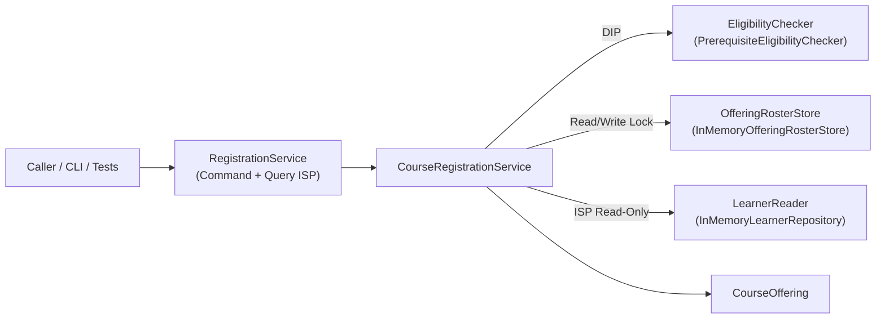

# Design Specification: Bounded Course Offering Registration & Waitlist Slice

## 1. Service Boundary & Scope

This module implements enrollment, dropping, and automatic FIFO waitlist promotion for **one bounded course offering** in Java 21, backed by thread-safe in-memory stores and a minimal CLI prototype.

### In Scope
- Enrolling eligible learners into a single `CourseOffering` up to its configured `capacity`.
- Enforcing prerequisite completion rules at both enrollment time and waitlist promotion time.
- Appending eligible learners to a strict FIFO waitlist when the offering is full, with idempotent handling of duplicate enrollment requests.
- Dropping enrolled or waitlisted learners safely, promoting the earliest currently eligible waitlisted learner when an enrolled seat opens, and returning deterministic outcomes on invalid or repeated drop requests.

### Explicitly Out of Scope
- Multi-offering course catalogs, multi-term schedules, frontend UI, authentication/identity integrations, payment processing, external RDBMS persistence, and configurable policy engines.

---

## 2. Architecture, SOLID Alignment & API Design

### SOLID Design Mapping
- **SRP**: Domain records (`Learner`, `CourseOffering`) hold pure validated state; `PrerequisiteEligibilityChecker` evaluates prerequisite satisfaction; `InMemoryOfferingRosterStore` manages $O(1)$ data structures; `CourseRegistrationService` coordinates thread-safe state transitions; `CourseRegistrationFactory` handles composition wiring.
- **OCP**: Pluggable `EligibilityChecker`, `LearnerReader`, `OfferingRosterStore`, and `RegistrationService` allow storage adapters or decorators (metrics, audit logging) without modifying `CourseRegistrationService`, while shipping one concrete policy within scope.
- **LSP**: `OfferingRosterStore` enforces explicit non-null canonical ID preconditions and capacity ceilings across implementations so in-memory and future concurrent/DB stores remain drop-in substitutable.
- **ISP**: Segregates `LearnerReader` from `LearnerRepository`, `OfferingRosterReader` from `OfferingRosterStore`, and `RegistrationQueryService` from `RegistrationCommandService`.
- **DIP**: `CourseRegistrationService` has zero compile-time imports of `InMemory*` classes; concrete wiring is isolated in `CourseRegistrationFactory`.

### Core Domain Records (`com.assessment.registration.model`)
All domain and API types are deeply immutable Java 21 `record`s or `enum`s with identifier normalization (`String.strip()`):
- **`CourseOffering(offeringId, title, capacity, requiredPrerequisites)`**: Enforces `capacity >= 1`, non-blank identifiers, immutable prerequisite set, and forbids self-referential prerequisites (`offeringId ∉ requiredPrerequisites`).
- **`Learner(learnerId, completedCourseIds)`**: Immutable snapshot of a learner's completed courses.
- **`EligibilityEvaluation(eligible, missingPrerequisites)`**: Returned by `PrerequisiteEligibilityChecker`; uses a zero-allocation `pass()` singleton on the happy path and a sorted `missingPrerequisites` set on failure.
- **`EnrollmentRecord(learnerId, enrolledAt, promotedFromWaitlist)`** & **`WaitlistEntry(learnerId, joinedAt)`**: Internal audit records stored in the roster and waitlist.

### Service API (`RegistrationService` / `CourseRegistrationService`)

| Method | Segregated Interface | Return Type | Semantics |
|---|---|---|---|
| `enroll(String learnerId)` | `RegistrationCommandService` | `EnrollmentResult` | Returns `ENROLLED`, `WAITLISTED` (with 1-based position), `ALREADY_ENROLLED`, `ALREADY_WAITLISTED`, `INELIGIBLE` (with missing prerequisites), or `INVALID_REQUEST`. Never throws on malformed/unknown learner IDs. |
| `drop(String learnerId)` | `RegistrationCommandService` | `DropResult` | Returns `DROPPED_FROM_ENROLLED` (with optional `promotedLearnerId` and `skippedIneligibleLearnerIds`), `DROPPED_FROM_WAITLIST`, `NOT_REGISTERED` (including duplicate drops), or `INVALID_REQUEST`. |
| `getOffering()` | `RegistrationQueryService` | `CourseOffering` | Returns the immutable offering configuration. |
| `getSnapshot()` | `RegistrationQueryService` | `OfferingSnapshot` | Consistent point-in-time read view of `capacity`, `enrolledCount`, `availableSeats`, ordered `enrolledLearnerIds`, and FIFO `waitlistedLearnerIds`. |
| `getLearnerStatus(String learnerId)` | `RegistrationQueryService` | `LearnerStatusView` | Live state (`ENROLLED`, `WAITLISTED` with current 1-based position, or `NOT_REGISTERED`). |
| `findEnrollmentRecord(String learnerId)` | `RegistrationQueryService` | `Optional<EnrollmentRecord>` | Returns enrollment timestamp and `promotedFromWaitlist` flag if enrolled. |

### Data Structure Optimization (`InMemoryOfferingRosterStore`)
Instead of pairing a `Queue<String>` with a separate `HashSet<String>` (which risks dual-structure drift and suffers $O(W)$ linear scans when a waitlisted learner drops from the middle of the queue), both `enrolled` and `waitlist` use Java 21 **`SequencedMap<String, ...>` (`LinkedHashMap`)**:
- `enrolled` is pre-sized via `LinkedHashMap.newLinkedHashMap(capacity)` (accounting for the `0.75` load factor) so the hash table **never resizes or rehashes**.
- Every core operation runs in **$O(1)$** (or **$O(1)$ amortized** for promotion):

| Operation | Data Structure Primitive | Time Complexity |
|---|---|---|
| Duplicate enrollment/waitlist check | `SequencedMap.containsKey` | $O(1)$ |
| Prerequisite eligibility check | `Set.containsAll` (`|P|` prerequisites) | $O(|P|)$ |
| Direct seat enrollment | `enrolled.putLast` | $O(1)$ |
| Waitlist tail insertion + initial position | `waitlist.putLast` + `waitlist.size()` | $O(1)$ |
| Drop enrolled learner | `enrolled.remove` | $O(1)$ |
| Drop arbitrary waitlisted learner (head/mid/tail) | `waitlist.remove` (doubly-linked unlink) | $O(1)$ |
| FIFO waitlist promotion | `waitlist.pollFirstEntry()` | $O(1)$ amortized |

---

## 3. Enrollment, Capacity & Queue Invariants

Every public state transition preserves the following invariants at lock release:

1. **Capacity Bound**: `0 <= enrolledCount <= capacity` and `availableSeats == capacity - enrolledCount`.
2. **Single Active Registration (Uniqueness & Disjointness)**:
   - Each learner ID appears at most once in `enrolled` and at most once in `waitlist`.
   - `enrolled ∩ waitlist = ∅` (an enrolled learner can never simultaneously join the waitlist, even if a duplicate `enroll` arrives while the offering is full).
3. **Strict Work-Conserving Queue Invariant**:
   - `enrolledCount < capacity ==> waitlist.isEmpty()`. Open seats and waiting learners never coexist after an operation completes.
4. **Prerequisite Validity at Entry**:
   - Every learner added to `enrolled` (directly or via promotion) satisfies `offering.requiredPrerequisites` at the moment of entry.
   - Every learner added to `waitlist` satisfies `offering.requiredPrerequisites` at the moment of waitlisting.

---

## 4. Stated Policy Assumptions & Waitlist-Promotion Rule

### Prerequisite Assumption
- A learner is eligible for an offering if and only if they exist in `LearnerRepository` and `learner.completedCourseIds().containsAll(offering.requiredPrerequisites())`.
- Partial completion is insufficient; Offerings with an empty `requiredPrerequisites` set allow any registered learner.
- Because a learner's academic record in `LearnerRepository` can change after they join the waitlist (e.g., conditional credit revoked or incomplete grade recorded), **eligibility is re-verified at promotion time**.

### Ineligible Waitlisted Learner Policy: **Skip & Evict**
When an enrolled learner drops (`enrolledCount` becomes `capacity - 1`), the service polls candidates from the head of the FIFO waitlist using `pollFirstEntry()`:
1. **Eligible candidate**: Immediately enrolled (`promotedFromWaitlist = true`), `promotedLearnerId` is populated on `DropResult`, and promotion stops because full capacity is restored.
2. **Ineligible candidate**: **Not promoted and skipped (evicted from the waitlist)**. Their ID is recorded in `DropResult.skippedIneligibleLearnerIds` in FIFO order, and promotion continues to inspect the next waitlisted learner until either an eligible learner is promoted or the waitlist becomes empty.
3. **Waitlisted learner drops**: Removing a waitlisted learner unlinks them in $O(1)$ and does **not** open an enrolled seat or trigger promotion.

### Why Skip & Evict Over Retain-in-Queue (Key Tradeoff)
- **Invariant preservation**: Retaining ineligible learners in the waitlist when `enrolledCount < capacity` violates the work-conserving invariant (`enrolledCount < capacity ==> waitlist.isEmpty()`). Without an external event trigger on `LearnerRepository` updates, a retained learner who later regains eligibility while a seat is open could be jumped by a newly arriving `enroll()` caller unless every `enroll()` also scans the waitlist.
- **$O(1)$ amortized complexity**: Under Retain-in-Queue, $k$ ineligible learners at the head of the waitlist must be re-scanned on *every* subsequent drop ($O(W)$ worst-case per drop). Under Skip & Evict, each waitlisted entry is polled and evicted at most once, guaranteeing strict **$O(1)$ amortized** promotion time.
- **Clean recovery**: An evicted learner whose prerequisite credit is later restored can cleanly call `enroll(learnerId)` again without stale waitlist state.

---

## 5. Concurrency & Persistence Approach

- **Persistence**: In-memory repositories (`InMemoryLearnerRepository` backed by `ConcurrentHashMap<String, Learner>` and `InMemoryOfferingRosterStore` backed by `LinkedHashMap`). Domain entities (`CourseOffering`, `Learner`, `EnrollmentRecord`, `WaitlistEntry`) are immutable records, preventing external aliasing bugs.
- **Concurrency Control**: `CourseRegistrationService` guards all roster/waitlist mutations with a fair **`ReentrantReadWriteLock(true)`**:
  - `enroll` and `drop` acquire the **write lock**, executing duplicate checks, live `LearnerRepository` eligibility lookup, roster mutation, and FIFO waitlist promotion as a single atomic critical section. Performing the `LearnerRepository` read *inside* the write lock eliminates Time-Of-Check-to-Time-Of-Use (TOCTOU) races where eligibility changes mid-enrollment.
  - `getSnapshot`, `getLearnerStatus`, and `findEnrollmentRecord` acquire the **read lock**, permitting concurrent non-blocking readers when no write is active while guaranteeing linearizable snapshots.
- **Duplicate Request Optimization**: `EnrollmentResult` returns the 1-based `waitlistPosition` upon initial waitlisting (`WAITLISTED`, $O(1)$ via `waitlist.size()`), and omits recalculating queue index on `ALREADY_WAITLISTED` so duplicate-enrollment floods remain strictly $O(1)$. Callers needing a learner's live waitlist index use `getLearnerStatus(learnerId)`.
